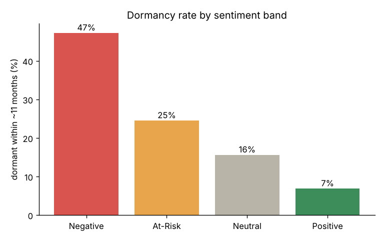
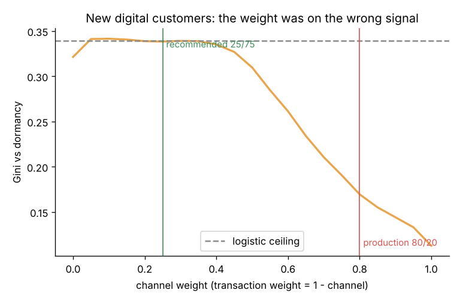

# Channel Sentiment Score (CSS)

[](https://github.com/SMLRE/channel-sentiment-score/actions/workflows/ci.yml)

A 0–100 behavioural score that detects retail customer disengagement **before** the customer goes dormant. It blends three signals: **digital channel success rate**, **balance trend** and **transaction velocity**. Each customer gets a band: **Positive / Neutral / At-Risk / Negative**.

> **About the data.** This is a public re-implementation of a production scoring system I built and validated at a commercial bank. The bank's data is proprietary and is **not** in this repo. The code runs on a synthetic generator that reproduces the structure of the problem: three customer paths, few channel attempts for new customers, and overdrawn balances. The "In production" section reports the real project. Everything after it comes from the synthetic data.



## In production (the real project)

| | |
|---|---|
| **Scale** | **3M+** retail customers scored, with output fed into the bank's customer-360 platforms |
| **Early validation (v1–v4)** | 0.7/0.3 channel/trend split: **AUC 0.797, Gini 0.593** against **280K+ known-dormant** customers |
| **v5 weight validation** | Supervised, outcome-based validation in Oracle SQL over an ~11-month window from t0 |
| **Established digital (ETB)** | **60/20/20 confirmed optimal**, with composite **Gini 0.35, matching the logistic ceiling** |
| **New digital (NTB)** | Production weights of 80/20 (channel/transactions) performed **~40% below** the logistic ceiling (relative). Rebalanced to **~25% channel / 75% transaction trend** |
| **Non-digital** | 50/50 balance / transaction |
| **Band recalibration** | Quantile matching, so band volumes stay stable after the weight change |

**What I fixed along the way**

1. **Hardcoded database credentials** in the original notebook (critical), moved out of code
2. Plain average of channel rates replaced with **volume-weighted aggregation**
3. **Overdraft-aware balance trend**: a signed log, so overdrawn accounts aren't dropped
4. **Bayesian shrinkage** for customers with few channel attempts
5. A **band-boundary gap bug** that left some scores without a band
6. A **grain issue** that created pseudo-replicated rows, fixed by aggregating to customer level through the account master

All of these are reproduced in this repo, apart from #1, which is a security fix with nothing to show.

## How it works

| Step | Where |
|---|---|
| Channel signal: volume-weighted success rate + shrinkage (k = 20) | `sql/01_channel_signal.sql` |
| Balance trend: slope of signed-log balance over 12 months | `sql/02_balance_trend.sql` |
| Transaction velocity: log ratio of the last 3 months vs earlier | `sql/03_txn_velocity.sql` |
| Dormancy outcome (validation only) | `sql/04_outcome.sql` |
| Percentile sub-scores within each path, weighted composite, bands | `src/score.py` |
| Weight grid search, logistic ceiling, Gini | `src/validate.py` |

The SQL is portable and runs on **DuckDB** here. The production version ran on Oracle.

## Results on the synthetic reproduction

The synthetic data was built so that the same findings can be rediscovered from scratch:

| Path | Production weights → Gini | Best on grid | Logistic ceiling | Recommended → Gini |
|---|---|---|---|---|
| Established digital | 60/20/20 → **0.483** | 0.484 | 0.483 | keep 60/20/20 |
| New digital | 80/20 → **0.170** | 0.342 | 0.340 | **25/75 → 0.338** |
| Non-digital | 50/50 → **0.494** | 0.494 | 0.492 | keep 50/50 |



**Why shrinkage matters** (Gini of the channel signal on its own, new digital customers): naive average **−0.150** → volume-weighted **−0.143** → + shrinkage **+0.113**. Without shrinkage, the signal points the wrong way for new customers.

**Bands after quantile-matched recalibration:** dormancy rate Negative **47%**, At-Risk 25%, Neutral 16%, Positive **7%**, a monotonic gradient of about 7×.

## Run it

```bash
pip install -r requirements.txt
python run_pipeline.py
```

Or open `notebooks/walkthrough.ipynb`.

## Repo layout

```
data/generate_synthetic.py   20k customers, 3 paths, monthly channel / balance / txn panels
sql/01..05_*.sql             signal pipeline (DuckDB / ANSI SQL)
src/signals.py               runs the SQL
src/score.py                 sub-scores, weights, bands, quantile-matched recalibration
src/validate.py              weight grid search + logistic ceiling
run_pipeline.py              end-to-end -> reports/
notebooks/walkthrough.ipynb  narrated, executed
```

## Author

**Oluwasemilore Sadare**, Data Scientist · [LinkedIn](https://www.linkedin.com/in/oluwasemilore-sadare) · [GitHub](https://github.com/SMLRE)
